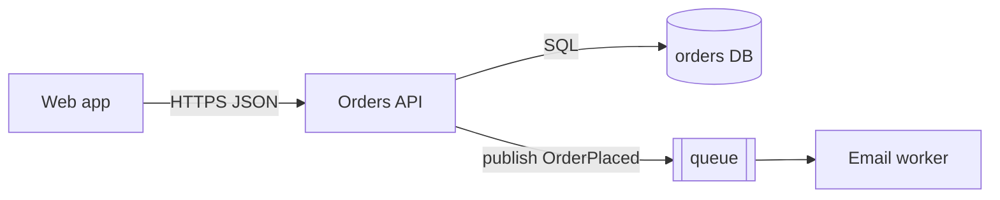

# Architecture Design

## Purpose

Make the few decisions that are expensive to reverse, make them on evidence, and write them down. Architecture is the set of choices about boundaries, data, contracts, and failure behavior. Everything else is implementation detail.

## When to open the references

| Need | Open |
|---|---|
| Compare options, write an ADR, weigh quality attributes | [decisions and ADRs](references/decisions-and-adrs.md) |
| Choose a structural pattern, cache, queue, or event design; spot anti-patterns | [patterns and anti-patterns](references/patterns.md) |
| Design a data model, schema migration, or API contract (REST, GraphQL, gRPC) | [data and API design](references/data-and-api.md) |

## Procedure

1. **Read what exists.** Find the project's architecture notes, ADRs, module layout, and dependency graph. Check their freshness against the code: run `git log -1 --format=%cs -- <doc>` and compare with the code it describes. Code is the truth for current behavior; docs are the truth for intent. Report drift.
2. **Establish drivers.** Write down, in measurable terms:
   - Functional requirements the design must serve.
   - Quality attributes with numbers: "p95 < 300 ms at 200 rps", not "fast". "RPO 5 min, RTO 1 h", not "reliable".
   - Constraints: team size and skills, existing stack, budget, compliance, deadlines.
   - Compatibility: who consumes the current contracts and data.
   Mark each driver as given (stated by the user or a spec) or assumed. Ask when an assumed driver would change the decision.
3. **Generate at least two viable options.** Always include "extend what exists" as one option. A design with one option is a preference, not a decision.
4. **Compare options** against the drivers with the option-comparison template. Score only the attributes that matter for this decision. Name the reversal cost of each option.
5. **Pick and bound.** Define components, their single responsibility, owned data, dependencies (direction matters), and data and control flow. One owner per piece of data.
6. **Specify contracts.** APIs, events, data models, error semantics, idempotency, pagination, and versioning. Contracts first; implementation follows.
7. **Design for failure.** For each external call and each queue: timeout, retry policy, idempotency, back-pressure, and what the user sees when it fails. For each datastore: backup, restore, and migration path.
8. **Plan the transition.** Prefer incremental, reversible steps: expand-and-contract migrations, strangler routing, feature flags. State the backward-compatibility window.
9. **Record decisions.** Write an ADR for any decision that is costly to reverse, crosses team boundaries, or rejects an obvious alternative. Match the repository's existing ADR location, numbering, and headings before using the default template.
10. **Define verification and rollout.** Name the tests, load checks, migration rehearsals, dashboards, and alerts that prove the design works, and the stage gates for rollout (see [release-management](../release-management/SKILL.md)).

## Scale the effort

| Change | Depth |
|---|---|
| New endpoint inside an existing module, same patterns | Steps 1, 5, 6. No ADR unless a contract becomes public. |
| New module, new datastore table, new external integration | Steps 1 to 8. One ADR if an alternative was rejected. |
| New service, new datastore technology, sync-to-async change, multi-team contract | All steps, ADRs, failure analysis, rollout plan, user review before build. |

## Outputs

- Architecture proposal: context, drivers, options compared, decision, component diagram (Mermaid or ASCII is fine), contracts, failure handling.
- Migration and rollout plan with backward-compatibility window and rollback point.
- ADRs for consequential decisions.
- Risks and open questions, each with an owner or a proposed experiment.

A minimal component diagram:

## Red flags

| Red flag | Do instead |
|---|---|
| "We will need microservices to scale" with one team and no load data | Modular monolith with enforced module boundaries; split when a measured driver demands it. |
| A new dependency or datastore with no driver that the current stack fails | Show the requirement the current stack cannot meet, with numbers, or drop it. |
| Two services write the same table | Give the data one owner; others call its API or consume its events. |
| A sync call chain of 3+ services on the user request path | Collapse the chain, cache, or move non-critical steps to async work. |
| Retries without idempotency | Add idempotency keys or natural keys before enabling retries. |
| A breaking contract change shipped in one step | Expand, migrate consumers, then contract. |
| An ADR written after the code merged, to justify it | Write the ADR at decision time; mark retroactive ADRs as such. |
| Diagram boxes with no stated responsibility or data owner | Each box gets one sentence of responsibility and its owned data. |

## Verification

- Every major decision traces to a driver or constraint. List the trace.
- Assumptions are labeled and the user confirmed the ones that change the outcome.
- Each external dependency has a timeout, retry, and failure behavior.
- Each schema or contract change has a compatibility and rollback story.
- Do not introduce a distributed system, new datastore, or new dependency without a justified need.
- A design review is not a passed gate until its blocking findings are resolved or explicitly accepted by the user.
